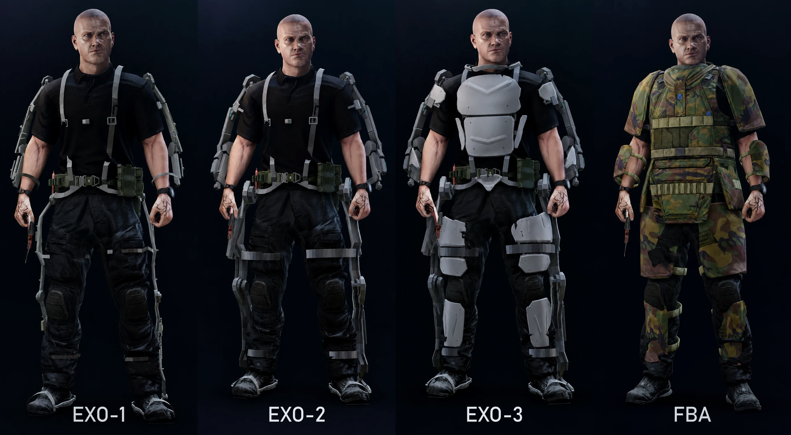

# Forge submission fields

**Mod GUID:** `com.silian.exoskeleton`

**Version:** `1.0.0` (server `ModMetadata.Version` and client `BepInPlugin` both say 1.0.0)

**License:** MIT

**SPT version:** 4.0.x

**Teaser (≤255):**
Modular full-body armor in class 5/6 Aramid, worn by boss-level armored GigaChads, plus three tiers of exoskeletons with sprint, stamina, weight and jump bonuses. You pay for those bonuses by wearing no armored gear.

**Dependencies:** SAIN 4.x (required), Fika (optional)

**Source code:** https://github.com/Silian1234/Exoskeleton.git

---

## Description (Markdown)

**FullBodyArmor** adds two things to Tarkov: modular full-body armor you have to take off a boss-tier enemy, and powered exoskeletons that trade armor for mobility.

### FBA modular full-body armor
- A carrier based on the FORT Redut-T5 with **no built-in protection**. Each zone takes a removable plate or panel: torso, sides, neck, shoulders, groin, thighs, calves and forearms.
- 20 removable **Aramid** pieces, each in **class 5** or **class 6**. Limb pieces are as durable as torso pieces.
- The armor isn't sold by traders or on the flea market. The only way to get it is to kill someone wearing it.

### Armored GigaChads
- By default, 1 in 5 GigaChad PMCs spawns in a **full class 5 or full class 6 set**.
- They get Tagilla-level skills, the **"ZABEY" welding mask** (a lootable copy) and spare magazines.
- Each one carries a **best-in-slot weapon build**: lowest recoil and highest ergonomics, built from vanilla parts only, with the largest magazine and the most armor-piercing ammo for its caliber. Builds: M4A1, HK416A5, Mk47 Mutant, AK-74M, AKM, AK-103, AK-12, Vector .45, Vector 9x19, SCAR-H, MCX-SPEAR, RPK-16.
- Every one of them is a boss fight.

### EXO exoskeletons (Ragman)
| | EXO-1 construction | EXO-2 military | EXO-3 assault |
|---|---|---|---|
| Ragman LL | 2 | 3 | 4 |
| Built-in protection | class 3 soft front/back | class 3 soft front/back | titanium plates: class 4 torso, class 3 everywhere else |
| Sprint speed | ×1.15 | ×1.20 | ×1.25 |
| Sprint and arm stamina drain | ×0.75 | ×0.65 | ×0.55 |
| Weight limits | +15 kg | +25 kg | +35 kg |
| Jump height | ×1.25 | ×1.35 | ×1.45 |
| Melee damage | ×2.0 | ×2.5 | ×3.0 |
| Fall damage cushion | 0.5 m | 1.0 m | 1.5 m |
| Vaulting while overweight | ×1.15 | ×1.20 | ×1.25 |
| Recoil | — | ×0.95 | ×0.90 |

**The catch:** an exoskeleton can't be worn with **any armored gear**: no armored helmets, masks, glasses or ballistic rigs. Regular headwear and rigs are fine. The EXO-3's titanium repairs poorly.

All three exoskeletons have their own 3D models.

### Localization
All item names and descriptions follow the game language, with translations for all 17 SPT languages.

### Installation
Extract the archive into your SPT folder. For Fika headless, also copy `BepInEx/plugins/FullBodyArmorClient` into the headless client.

### Configuration
`SPT/user/mods/FullBodyArmor/config.json`: armored GigaChad share, class 6 share, on/off switch.

### Compatibility
- Requires **SAIN**. The client plugin also fixes SAIN 4.4.2 assigning personalities to PMCs.
- Works with APBS (armor is applied after bot generation).
- Fika: bonuses apply to the local player only.
