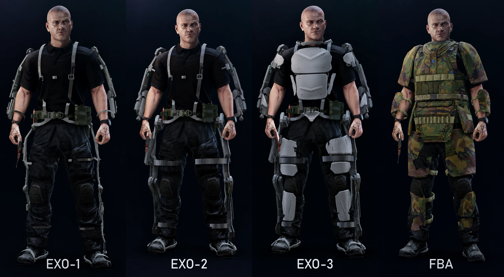

**Exoskeleton From TushonkaGroup** adds two things to Tushonka: modular full-body armor you have to take off a boss-tier enemy, and powered exoskeletons that trade armor for mobility.

## FBA modular full-body armor
- A carrier based on the FORT Redut-T5 with **no built-in protection**. Each zone takes a removable plate or panel: torso, sides, neck, shoulders, groin, thighs, calves and forearms.
- 20 removable **Aramid** pieces, each in **class 5** or **class 6**. Limb pieces are as durable as torso pieces.
- The armor isn't sold by traders or on the flea market. The only way to get it is to kill someone wearing it.

## Armored GigaChads
- By default, 1 in 5 GigaChad PMCs spawns in a **full class 5 or full class 6 set**.
- They get Tagilla-level skills, the **"ZABEY" welding mask** (a lootable copy) and spare magazines.
- Each one carries a **best-in-slot weapon build**: lowest recoil and highest ergonomics, built from vanilla parts only, with the largest magazine and the most armor-piercing ammo for its caliber.
- Builds: M4A1, HK416A5, Mk47 Mutant, AK-74M, AKM, AK-103, AK-12, Vector .45, Vector 9x19, SCAR-H, MCX-SPEAR, RPK-16.
- **Berserk:** they fight harder than normal GigaChads. Higher SAIN aggression (they push sooner and hold ground longer), full suppression resistance, and they charge at noises instead of waiting.
- Every one of them is a boss fight.

## EXO exoskeletons (sold by Ragman)
| | EXO-1 construction | EXO-2 military | EXO-3 assault |
|---|---|---|---|
| Ragman LL | 2 | 3 | 4 |
| Built-in protection | class 3 soft front/back | class 3 soft front/back | titanium plates: class 4 torso, class 3 everywhere else |
| Sprint speed | ×1.15 | ×1.20 | ×1.25 |
| Sprint and arm stamina drain | ×0.75 | ×0.65 | ×0.55 |
| Weight limits | +15 kg | +25 kg | +35 kg |
| Jump height | ×1.25 | ×1.35 | ×1.45 |
| Melee damage | ×2.0 | ×2.5 | ×3.0 |
| Fall damage cushion | 0.5 m | 1.0 m | 1.5 m |
| Vaulting while overweight | ×1.15 | ×1.20 | ×1.25 |
| Recoil | — | ×0.95 | ×0.90 |

**The catch:** by default an exoskeleton can't be worn with **any armored gear**: no armored helmets, masks, glasses or ballistic rigs. Regular headwear and rigs are fine. The EXO-3's titanium repairs poorly.

Don't like the catch? Each kind of armored gear (helmets, masks, glasses, rigs) can be allowed in the **F12 menu**. It applies immediately, and the item descriptions follow the setting after a server restart.

All three exoskeletons have their own 3D models.

## Localization
Item names and descriptions follow your game language. All 17 SPT languages are included.

## Requirements
- SPT 4.1.x (tested on 4.1.6). For SPT 4.0.x use version 1.0.0.
- **SAIN** 4.5.x (required) with BigBrain. The client plugin also fixes SAIN not applying nickname personalities to PMCs.
- Fika (optional). Exoskeleton bonuses apply to the local player.

## Installation
Extract the archive into your SPT folder:
- `SPT_Runtime/user/mods/FullBodyArmor/` (server mod)
- `BepInEx/plugins/FullBodyArmorClient/` (client plugin)

For Fika headless, also copy the client plugin into the headless client's `BepInEx/plugins`.

## Configuration
Press **F12** in game, section *FullBodyArmor Client*:
| Setting | Default | Meaning | Applies |
|---|---|---|---|
| Enabled | on | Armored GigaChads on/off | next raid |
| Share of GigaChads | 0.2 | Share of GigaChad PMCs that get the armor | next raid |
| Class 6 share | 0.5 | Share of armored ones in class 6 (the rest get class 5) | next raid |
| Berserk | on | Armored GigaChads fight harder | bots spawned after the change |
| Aggression multiplier | 2.0 | How much harder (SAIN aggression multiplier) | bots spawned after the change |
| Allow armored helmets / masks / glasses / ballistic rigs | off | Wear that armored gear with an exoskeleton | immediately |

The settings are stored on the server (`SPT_Runtime/user/mods/FullBodyArmor/config.json`) and shared by everyone on it. Only the **settings owner** can change them: the first profile that changes a setting becomes the owner (`SettingsOwnerProfileId` in `config.json`). On a Fika server, changes from other players are refused.

## Compatibility
- Works with APBS: the armor is applied after bot generation.
- The exoskeleton conflicts with armored gear only. Clothing and other gear mods are unaffected.

## Changelog
**1.1.0** (SPT 4.1.x)
- Ported to SPT 4.1 and SAIN 4.5.
- F12 settings menu.
- Armored GigaChads go berserk (configurable).
- Armored helmets, masks, glasses and rigs can be allowed with exoskeletons.

**1.0.0** (SPT 4.0.x): first release.

## Source code
https://github.com/Silian1234/Exoskeleton.git (MIT)
