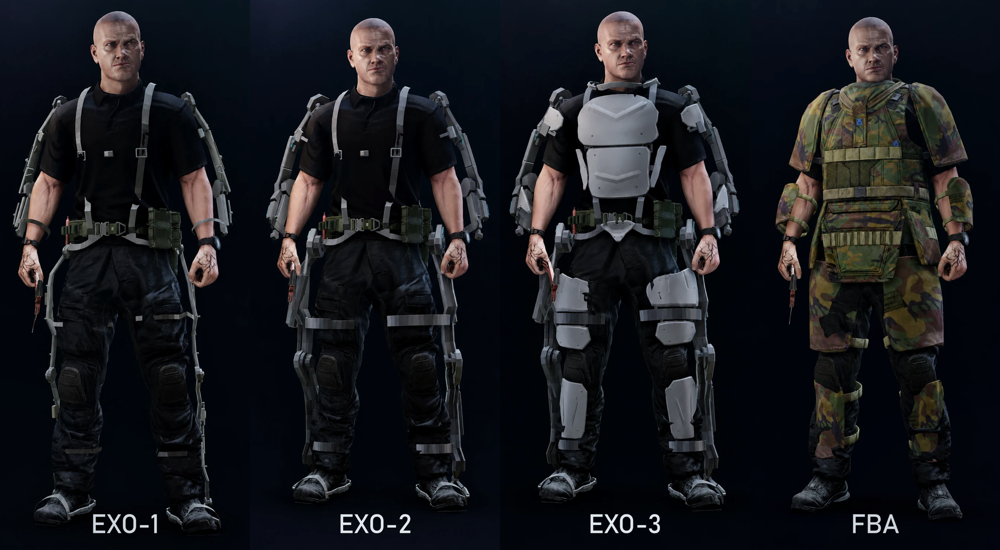

# FullBodyArmor



Modular full-body armor and three tiers of powered exoskeletons for **SPT 4.1.x** (tested on SPT 4.1.6, EFT 0.16.9.5.40743, SAIN 4.5.1, Fika 2.4.6). Fika compatible.

## Features

### FBA modular full-body armor
- A carrier based on the FORT Redut-T5 with **no built-in protection**. Every zone takes a removable plate or panel: torso, sides, neck, shoulders, groin, thighs, calves and forearms.
- 20 removable Aramid pieces, each in **class 5 or class 6**. Limb pieces are as durable as torso pieces.
- **Armored GigaChads.** A configurable share of GigaChad PMCs (20% by default) spawn in a full class 5 or full class 6 set. They also get Tagilla-level skills, the "ZABEY" welding mask (a lootable copy), a unique weapon build and spare magazines. By default they also fight harder than normal GigaChads (berserk: higher SAIN aggression, full suppression resistance, they charge noises). They fight like a boss, and killing one is the only way to get the set: the carrier and pieces can't be sold on the flea market and aren't sold by traders.

### EXO exoskeletons (sold by Ragman)
| Tier | Item | Ragman LL | Built-in protection |
|---|---|---|---|
| 1 | EXO-1 construction exoskeleton | 2 | class 3 soft front/back |
| 2 | EXO-2 military exoskeleton | 3 | class 3 soft front/back |
| 3 | EXO-3 assault exoskeleton | 4 | titanium plates: class 4 torso, class 3 sides/neck/shoulders/forearms/groin/thighs/calves (titanium repairs poorly) |

| Bonus (per tier 1 / 2 / 3) | |
|---|---|
| Sprint speed | ×1.15 / ×1.20 / ×1.25 |
| Sprint and arm stamina drain | ×0.75 / ×0.65 / ×0.55 |
| Weight limits | +15 / +25 / +35 kg |
| Jump height | ×1.25 / ×1.35 / ×1.45 |
| Melee damage | ×2.0 / ×2.5 / ×3.0 |
| Fall damage cushion | 0.5 / 1.0 / 1.5 m |
| Vaulting while overweight | ×1.15 / ×1.20 / ×1.25 |
| Recoil | — / ×0.95 / ×0.90 |

The price for these bonuses: an exoskeleton **can't be worn with any armored gear**, including armored helmets, masks, glasses and ballistic rigs. Regular clothing and gear still work.
Each kind of armored gear can be allowed in the F12 menu or in `config.json` (`ExoAllowArmored*`); item descriptions follow the setting after a server restart.

### Localization
All item texts are in `server/locales.json` for all 17 SPT languages. A missing key falls back to English.

## Requirements
- SPT 4.1.x (for SPT 4.0.x use release 1.0.0)
- SAIN 4.5.x (required) with its dependency BigBrain. The client plugin also fixes SAIN applying nickname personalities to PMCs (still broken in 4.5.1).
- Fika (optional)

## Installation
Extract the release archive into your SPT folder:
```
SPT_Runtime/user/mods/FullBodyArmor/    server mod (DLL, locales.json, config.json, bundles)
BepInEx/plugins/FullBodyArmorClient/    client plugin
```
For Fika headless, also copy the client plugin into the headless client's `BepInEx/plugins`.

## Configuration
Everything except the debug switch is in the **F12 menu** (BepInEx Configuration Manager, section *FullBodyArmor Client*).
The values live on the server (`SPT_Runtime/user/mods/FullBodyArmor/config.json`) and are shared by everyone on it.
Only the **settings owner** can change them: the first profile that changes a setting becomes the owner
(`SettingsOwnerProfileId`); changes from other profiles (for example Fika guests) are refused.
GigaChad settings apply from the next raid, berserk to bots that spawn afterwards, the exoskeleton armor rule immediately.

| Key | Default | Meaning |
|---|---|---|
| `GigaChadArmorEnabled` | `true` | Armored GigaChads on/off |
| `ArmoredGigaChadShare` | `0.2` | Share of GigaChad PMCs that get the armor |
| `Class6Share` | `0.5` | Share of armored ones that get class 6 (the rest get class 5) |
| `TestScavsWearCarrier` | `false` | Debug: every Scav wears the carrier |
| `ArmoredGigaChadBerserk` | `true` | Armored GigaChads fight harder: higher SAIN aggression, full suppression resistance, Wreckless-style searching |
| `ArmoredGigaChadAggression` | `2.0` | SAIN `AggressionCoef` multiplier for them (higher = they push sooner and hold ground longer) |
| `ExoAllowArmoredHelmets` | `false` | Allow armored helmets with exoskeletons |
| `ExoAllowArmoredFaceCovers` | `false` | Allow armored masks with exoskeletons |
| `ExoAllowArmoredEyewear` | `false` | Allow armored glasses with exoskeletons |
| `ExoAllowArmoredRigs` | `false` | Allow ballistic rigs with exoskeletons |
| `SettingsOwnerProfileId` | `""` | Profile allowed to change settings from F12 (empty: the first one that does) |

SAIN 4.5 picks personalities on the client, so the client plugin reports the active SAIN preset's personality table to the server, which keeps it in `sain-assignments.json`.

## Building from source
Requires the .NET 10 SDK and an SPT 4.1 install (the projects reference its DLLs).
```
dotnet build server -c Release -p:SptDir=C:\SPT41
dotnet build client -c Release -p:SptDir=C:\SPT41
```
`SptDir` defaults to `C:\SPT41`; the server DLLs are read from `$(SptDir)/SPT_Runtime` (override with `-p:SptServerDir=...`).

## Repository layout
| Path | Contents |
|---|---|
| `server/` | Server mod (C#, net10.0): items, armor kits, GigaChad bot post-processing, exoskeleton items, localization, settings routes |
| `server/config/` | Default `config.json`, `bundles.json`, weapon builds, magazine sanitize table |
| `client/` | BepInEx plugin (C#, netstandard2.1): exoskeleton mechanics, SAIN fixes, F12 settings |
| `tools/` | Asset pipeline scripts: Blender export and checks, Unity bundle build, bundle patching |
| `tools/exo_model/` | Blender scripts that build the exoskeleton models procedurally |

Obfuscated game members are resolved at runtime by signature (`client/ExoResolve.cs`), not by their obfuscated names. None of this mod's code is obfuscated.

## License
See [LICENSE](LICENSE).
